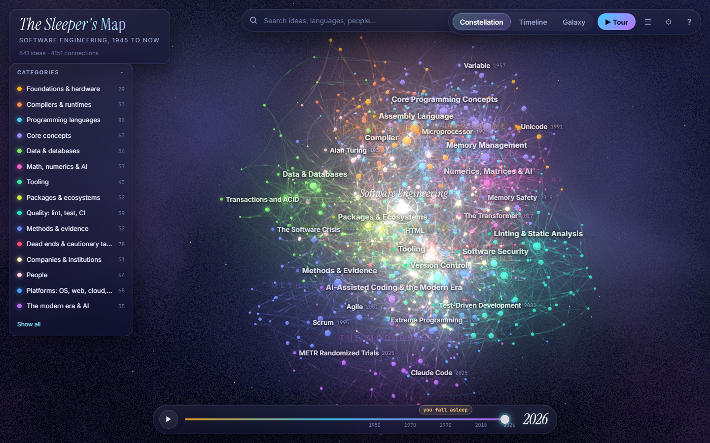
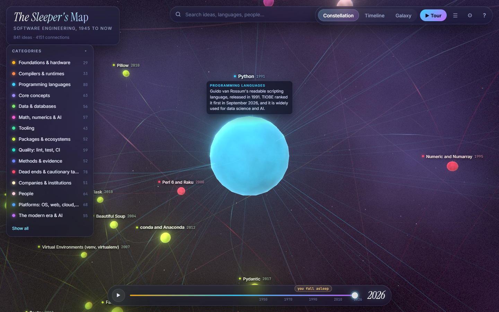
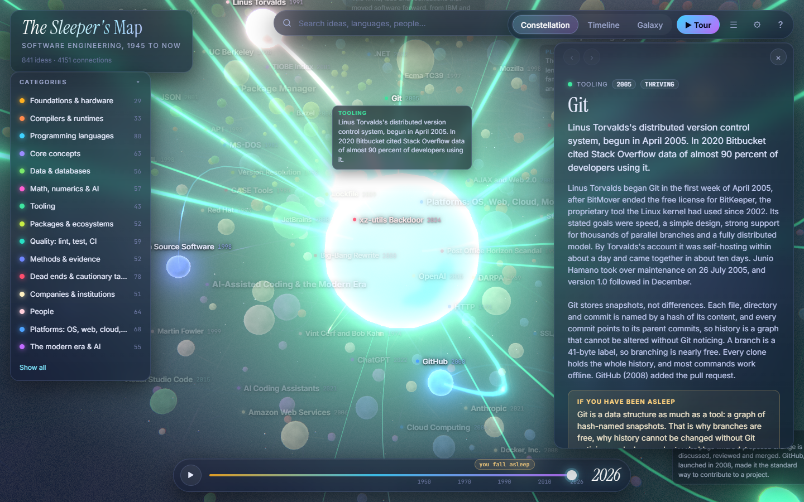
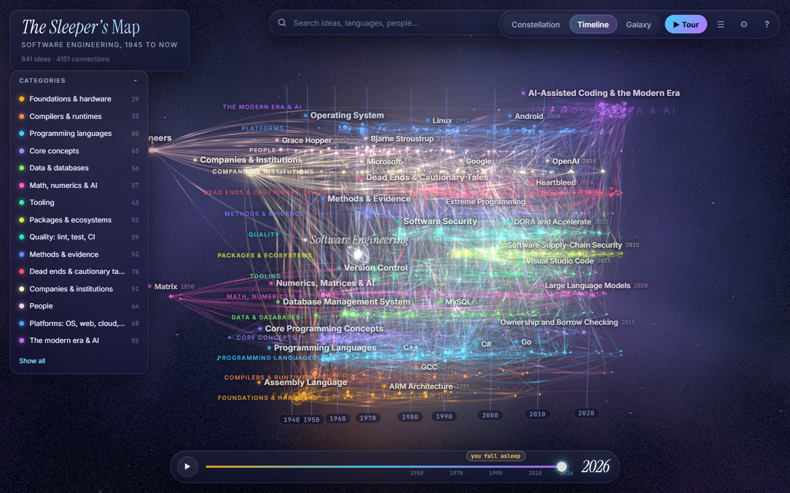
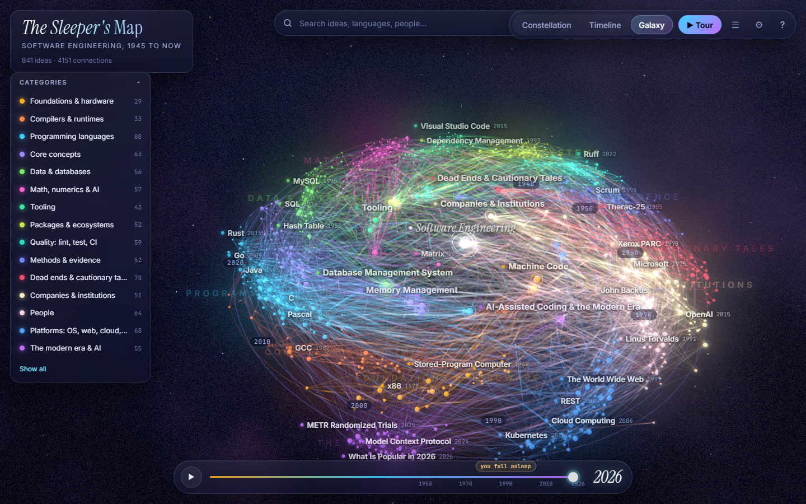
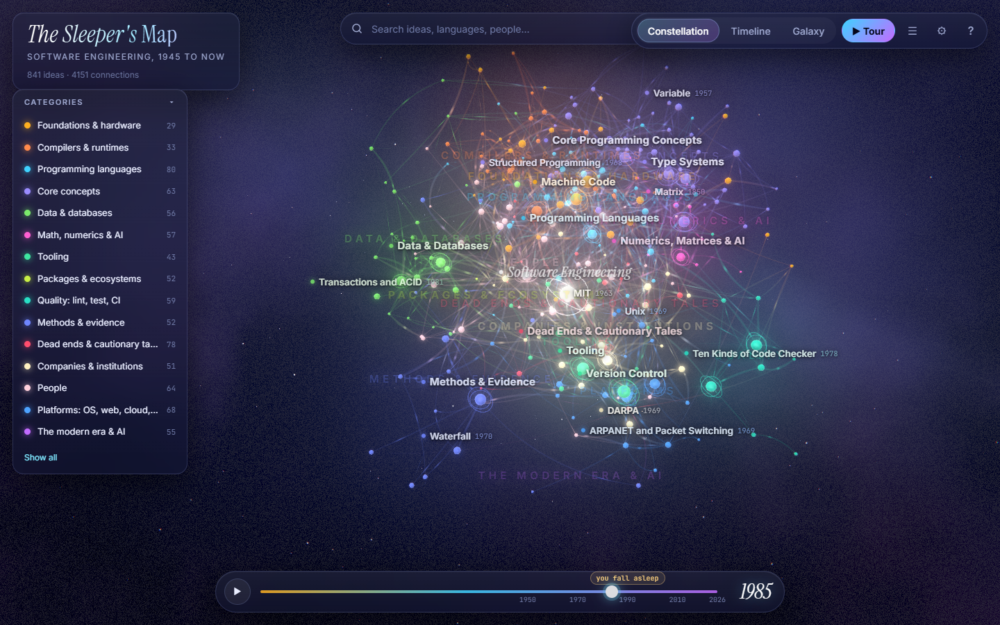
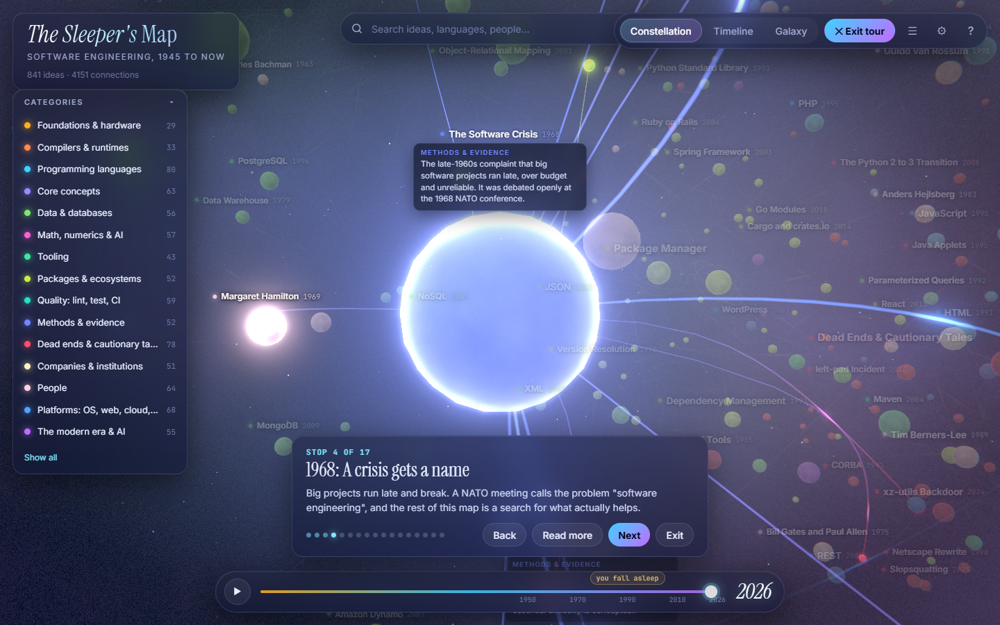
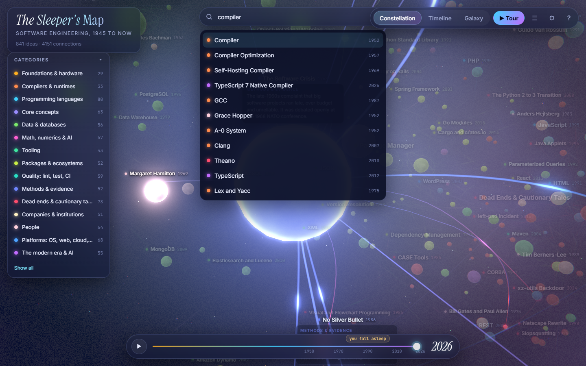
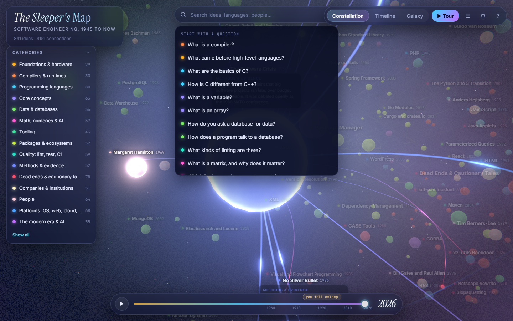

# The Sleeper's Map

An interactive 3D map of the history of software engineering, from hand-set machine code to AI that writes code. It is built for someone who stopped following software 30 to 40 years ago and wants to catch up. Every glowing point is an idea, a language, a tool, a company, a person or a mistake, and the links show what led to what.

**Open `Software Engineering Map.html`.** It is one self-contained file of about 2.3 MB. It needs no server and no internet connection, and it works from a double-click in any current browser that supports WebGL 2.



## Where to start

- **Click the search box.** With nothing typed, it lists 18 starter questions ("What is a compiler?", "How is C different from C++?", "What has been proven not to work?"). Each one flies to the node that answers it.
- **Take the tour.** Press `T` for 17 stops in chronological order, from the first stored-program computer in 1948 to AI-written code now.
- **Time-travel.** The slider at the bottom hides everything newer than the chosen year. A marker shows where you "fall asleep" in 1990, and the play button replays history from the 1840s onward.

## What is in the map

841 ideas joined by 4,151 weighted connections, in 15 categories. Bigger nodes are bigger ideas, and brighter, shorter links mean closer relevance.

| Category | Ideas | What it holds |
|---|---:|---|
| Foundations & hardware | 29 | Machine code, assembly, early computers and instruction sets |
| Compilers & runtimes | 33 | Compilers, interpreters, virtual machines, linkers and garbage collectors |
| Programming languages | 80 | Notable languages, their syntax and what defined them, including C and C++ side by side |
| Core concepts | 63 | Variables, types, arrays, pointers, functions, objects, concurrency and algorithms |
| Data & databases | 56 | Data structures, SQL, relational and NoSQL databases |
| Math, numerics & AI | 57 | Matrices, numerical libraries, the Python scientific stack, machine learning and GPUs |
| Tooling | 43 | Version control, build systems, editors, IDEs and debuggers |
| Packages & ecosystems | 52 | Package managers, registries, important libraries and supply-chain security |
| Quality: lint, test, CI | 59 | The kinds of linting, static analysis, testing and continuous integration |
| Methods & evidence | 52 | Methodologies, laws, books and what the research says |
| Dead ends & cautionary tales | 78 | Ideas that did not work and famous failures |
| Companies & institutions | 51 | Companies, labs, foundations and standards bodies |
| People | 64 | Pioneers and builders |
| Platforms: OS, web, cloud, mobile | 68 | Operating systems, the Internet, the web, cloud and mobile |
| The modern era & AI | 55 | What is popular now and how AI is changing coding |

Every idea has a one-line description that appears as you zoom in and a longer text in the detail panel. 374 ideas carry an "If you have been asleep" note about what changed since the late 1980s, 289 carry a code sample (in 63 languages and file formats), and 768 link to sources under "Read more".

### The questions you asked, and where they are answered

Open the map and use the search box, or search for the title in the second column.

| You asked | Start with |
|---|---|
| What is a compiler? | Compiler, then Lexer, Parser, Optimizer, Code Generator |
| Assembly language, and what came before | Assembly Language, Machine Code, Stored-Program Computer |
| What are the basics of C, and how does it differ from C++? | C Basics: Syntax and Structure, C versus C++ |
| How do you program with databases, arrays and variables? | SQL Queries and Joins, Database Driver APIs, Array, Variable |
| What types of linting are there? | Linting & Static Analysis, then the tools it links to (ESLint, Ruff, mypy, SAST, formatters) |
| What is a matrix? | Matrix, Matrix Multiplication, NumPy |
| Which Python packages matter? | NumPy, SciPy, pandas, Matplotlib, scikit-learn, PyTorch, and the web and tooling packages around them |
| What are package managers? | Package Manager, then npm, pip, Cargo, uv and the others |
| What is popular now? | What Is Popular in 2026, TIOBE Index, Stack Overflow Developer Survey |
| What has worked? | Methods & Evidence, Git, Continuous Integration, Structured Programming, Relational Model |
| What has been proven not to work? | Dead Ends & Cautionary Tales |
| Which companies and people mattered? | Companies & Institutions, Pioneers |

## What you can do

- **Orbit, pan and zoom.** Drag to orbit, scroll or pinch to zoom toward the pointer, right-drag or two fingers to pan.
- **Read at any depth.** Titles float above the nodes. As you zoom in, a node grows a short description. Click a node to fly to it and open the full text, the "for the sleeper" note, a code sample where one helps, and every connection grouped by relationship.
- **Follow the connections.** Hover to light up a node's neighborhood and dim the rest. Click a connection chip to jump there. The back and forward buttons retrace your path.
- **Change the layout.** Constellation groups ideas by relevance. Timeline lines them up by year with a lane per category. Galaxy spirals outward through time.
- **Search and filter.** Press `/` to search. Click a category in the legend to hide or show it, and double-click to isolate it.

| Key | Action |
|---|---|
| `/` | Search, or pick a starter question |
| `1` `2` `3` | Constellation, Timeline, Galaxy |
| `T` | Guided tour |
| `P` | Replay history |
| `L` | List view of every idea |
| `R` | Reset the view |
| `←` `→` | Previous or next connection (or tour stop) |
| `[` `]` | Back or forward |
| `?` | Help |
| `Esc` | Close |

Everything works on a phone-width screen with touch. The map respects the operating system's reduced-motion setting. If WebGL is unavailable, the page shows the complete list of ideas instead, so nothing is lost. A link such as `Software%20Engineering%20Map.html#n=lang.c&l=timeline` opens straight to a node and layout.

## Screenshots

| | |
|---|---|
|  |  |
|  |  |
|  |  |
|  |  |

## Where the content comes from

The text comes from a deep-research pass that ran twelve independent topic researchers (early languages and compilers, C and Unix, mainstream languages, functional and legacy languages, data and databases, matrices and the Python ecosystem, version control and packaging, linting and testing, methodologies and failures, companies and people, platforms, and the AI era). Their notes, with sources, are in `../research_notes/Software engineering history 1945 to 2026/`. A 31,000-word report that synthesizes them is the long-form version of this map: `../reports/Software engineering history 1945 to 2026.md`, with a copy in this project at `docs/Software engineering history 1945 to 2026 (report).md`.

The map's nodes were then written against those notes, one slice per topic, and a second pass compared each node's dates, figures and quotations with the notes again. Some points are worth knowing:

- Where sources disagreed, the text says so ("sources differ", "reported").
- Figures from a vendor's own blog or a single secondary summary are labeled as such, not stated as fact.
- Several well-known stories are flagged as myths or disputed, for example who found the first computer bug, whether Royce coined "waterfall", and the 640K quotation.
- Items dated 2026 (valuations, product launches, survey results, pending acquisitions) were read through summarizing tools and may have changed since. The detail panel says "reported" where that matters.
- Code samples were checked by hand or with a compiler where one was installed. Python was not installed on the build machine, so Python samples were checked by reading.

`node scripts/check-links.mjs` checks every "Read more" link. At the last run, 912 unique links were checked: 870 answered normally, 42 refused automated requests (typically 403 or 429 from publishers, or certificate quirks), and none were dead.

## Project layout

```
Software Engineering Map.html   the built, self-contained map (a copy of dist/software-engineering-map.html)
data/
  categories.json               the categories and their colors
  src/*.json                    node and edge slices, written against the registry (registry.json)
  tour.json                     the guided tour
  questions.json                the starter questions
  required-topics.json          topics the release data must cover
  graph.json                    merged and validated dataset (generated)
src/                            the viewer: scene, shaders, labels, UI, styles, HTML template
scripts/                        merge, validate, layouts, build, slice checker, link checker
tests/                          data, layout and end-to-end browser tests
screenshots/                    images produced by the end-to-end tests
docs/                           plan, data style guide, authoring tasks, learnings, a copy of the research report
```

## Rebuild and test

Requires Node 22 or newer and Microsoft Edge (the tests drive it through `playwright-core`; set `EDGE_PATH` for a different location).

```
npm install
npm run build        # merge and validate the data, compute layouts, write the HTML
npm test             # strict data validation, build, then data, layout and browser tests, and refresh the screenshots
SMAP_SOFTWARE_GL=1 npm run test:e2e   # run the browser tests on software rendering
node scripts/check-links.mjs          # optional: verify every "Read more" link (needs network)
```

`npm test` enforces the release bars: at least 500 nodes and 1,500 edges, every category populated, every hub with at least eight connections, every required topic present, a tour of at least ten stops and at least ten starter questions. The browser tests load the built file over `file://` and check, among other things, that nothing is requested from the network, that hub titles show at overview and that zooming up to every hub, and to a sample of other nodes, shows the title, that title labels never overlap, that clicks and drags behave, that the phone layout does not overflow, that the page degrades when WebGL is blocked, and that a generated 3,000-node graph still renders at a usable frame rate. On the development machine (Radeon RX 7800 XT) the full map holds about 150 frames per second. On software rendering (SwiftShader, as in a virtual machine or a remote desktop) the page detects the renderer, starts on the low preset at reduced resolution, and holds about 9 frames per second; on any machine, the frame-time governor steps the quality down by itself if frames take too long, and the Settings menu can pin a preset.

## How it is built

- **Rendering.** three.js with custom shaders. Nodes and halos are instanced. Edges are curves evaluated on the GPU from a position texture and drawn as camera-facing ribbons with category gradients and traveling pulses. Bloom, a nebula backdrop and soft category clouds finish the look. Glow and edge brightness are set from the size of the graph, so dense graphs stay readable.
- **Labels.** A DOM layer projected every frame. Labels are ranked by importance and on-screen size, collisions are rejected, and the node the camera is aimed at always wins its label. Labels never take pointer input; the canvas does hit-testing for them.
- **Layouts.** `d3-force-3d` computes the three layouts at build time, seeded so they are identical every run. The browser only interpolates between them.
- **One file.** esbuild bundles the code, and the build inlines the script, styles, data and fonts (Inter, JetBrains Mono, Instrument Serif; all SIL Open Font License) into the HTML. A test confirms the page makes no network requests.

## Adding or changing content

Edit or add a slice in `data/src/`, following `docs/data-style-guide.md`, then run `node scripts/check-slice.mjs data/src/<file>.json` and `npm test`. The validator reports dangling edges, disconnected nodes, over-long text and other problems before anything is built. `node scripts/suggest-links.mjs --write` adds structural links for thin spots.

## Credits and licenses

Code in this project is MIT licensed. It bundles [three.js](https://threejs.org) (MIT) and [d3-force-3d](https://github.com/vasturiano/d3-force-3d) (MIT). Fonts are from [Fontsource](https://fontsource.org) packages under the SIL Open Font License 1.1. The research and the node text were produced with Claude, and the research notes list the sources behind them.
